# Agent Zero: conversational investigative intelligence proposal

**Status:** Draft for product and architecture review; not approved for implementation.
**Purpose:** Evolve Agent Zero from direct WhatsApp-to-investigation intake into a natural conversational interface over the existing investigative engine, with a future provenance-aware cross-investigation knowledge layer.
**Scope:** Product direction, logical architecture, system ownership, staged implementation, safety and evaluation requirements. This document does not claim that conversational memory, organization workspaces, cross-case discovery, or n8n integration currently exist.

## 1. Product direction

**Natural conversation by default. Explicit approval for consequential actions. Structured investigative intelligence underneath.**

A user should be able to greet the agent, ask what it can do, discuss a developing story, provide context, and ask about an existing case in ordinary language. A conversation about an allegation is not itself authorization to create a persistent investigation or start a costly research job. When the user asks for a substantive investigation, Agent Zero should clarify its scope, show the proposed claim or question, and ask for a clear approval before creating the case.

The system has three related capabilities, with different maturity levels:

1. **Conversational intelligence:** understands conversational context, explains capabilities, asks useful questions, and routes requests. This is the first experience layer to build using GPT Luna through a bounded application task.
2. **Investigative intelligence:** creates authorized cases and uses the existing durable worker, orchestrator, source retrieval, evidence validation, assessment, and brief pipeline. This exists today, but WhatsApp currently bypasses Luna's triage and immediately creates a case for most text.
3. **Cumulative intelligence:** connects claims, sources, evidence, events, and prior cases to help investigators find relevant history and gaps. This is a future evidence and knowledge layer; it is not supplied by LLM chat memory and must be developed with provenance, access controls, and evaluation.

### Product principles

- Natural language is the primary interaction. Commands, references, and buttons are optional shortcuts.
- Ordinary conversation does not create an investigation.
- The user approves the exact scope before a new case is committed.
- GPT Luna proposes interpretations and structured analysis; application code controls authorization, persistence, budgets, evidence eligibility, lifecycle and final output.
- A reference identifies a case but is not permission to access it.
- Prior findings and popularity are context, not proof. Evidence provenance and source independence remain visible.
- Persistent learning means accumulating traceable evidence and relationships first; automatic model retraining or self-modification is out of scope.

## 2. Current baseline and the gap

The current backend already has useful building blocks:

- `ModelGateway.extract_claims_and_queries` uses GPT Luna for structured claim extraction, claim type classification, normalization, focused query proposals, and a clarification question when critical scope is ambiguous.
- `POST /api/v1/investigations/triage` runs that task and pauses before research. `POST /api/v1/investigations/{id}/continue` accepts reviewed claims and queues the worker.
- The Celery worker and orchestrator manage bounded research, retrieval, evidence and claim relationships, structured reasoning, validation, and brief generation. GPT Luna proposes structured outputs; application code and persisted evidence constrain final assessments.
- Existing investigations, claims, sources, evidence, source relationships, findings, briefs, job state, and audit events are persisted in PostgreSQL.
- WhatsApp has separate direct Meta and ClickCast adapters plus sender-scoped result lookup.

The gap is at the conversation boundary. The current direct Meta handler treats every non-`RESULT` text as a new investigation and immediately calls `InvestigationService.create`. ClickCast similarly creates an investigation from text or URL. Both bypass the existing triage-and-confirmation experience. There is no persistent WhatsApp conversation/draft layer, natural case-history retrieval, or cross-investigation knowledge service. The current triage route also resolves the development owner only when auth is disabled in development/test; it is not yet a secure WhatsApp integration contract.

This means the existing “brain” is present in the analysis pipeline, but the channel does not consistently use it before committing work.

## 3. Target user journey

### 3.1 Natural conversation, no case by default

**User:** Hi.

**Agent Zero:** Hi, I’m Agent Zero. I help investigate factual claims and examine public evidence. You can ask a question, talk through a developing story, or ask me to investigate a specific claim. What are you looking into?

No case is created and no research job is queued.

The same applies when the user asks what Agent Zero does, shares background, or discusses an allegation without requesting an investigation. GPT Luna may respond conversationally using the bounded context available to that task. The response must not imply fresh research if none was performed. General factual answers still need freshness and evidence controls appropriate to their claims.

### 3.2 Detect an investigation request and prepare a preview

**User:** I want you to investigate whether Company X received the government contract before the tender was publicly announced.

The conversation layer sends the message and relevant conversation context to Agent Zero's authenticated triage capability. GPT Luna identifies a proposed claim, relevant qualifiers, and any ambiguity. If needed it asks a targeted clarification. If sufficiently clear, it presents a preview:

> Here’s what I understand you want investigated:
>
> **Claim:** Company X received the government contract before the tender was publicly announced.
>
> I’ll look for relevant procurement records, announcement dates, and independent reporting where available. I’ll distinguish retrieved evidence from allegations and show important gaps.
>
> **Submit investigation** · **Edit** · **Cancel**

No investigation record or research job is committed yet. An expiring draft may exist to hold this preview; draft persistence, data minimization and TTL are design decisions in Phase 1.

### 3.3 Explicit approval commits one case

When the user selects **Submit investigation** (or clearly confirms in natural language), Agent Zero validates the authenticated owner, draft version and expiry; verifies the confirmation idempotency key; then atomically creates one investigation and durable outbox/job event. The worker uses the approved claim set as its scope. The user receives a stable reference and a clear distinction between “accepted” and “delivered” if WhatsApp send status is unknown.

> Your investigation has been registered.
>
> **Reference:** AZ-2026-00421
>
> I’ll investigate the claim and assess the available evidence. You can ask me for an update or return to this reference later.

A reference is a locator, not an access token.

### 3.4 Continue the conversation around a case

The user may ask, “What are you looking for first?” The agent answers from the persisted approved scope and research state. The user may say, “I found a procurement document.” During the initial release, Agent Zero can explain that text or a public URL is supported, associate the contribution with the selected case only after resolving which case and confirming the attachment, and distinguish user-provided material from independently retrieved evidence. Merely mentioning a document in conversation does not admit it as validated evidence.

### 3.5 Retrieve a case naturally or with shortcuts

The user can say, “What’s happening with my investigation?” or “Show my recent investigations.” Agent Zero lists only authorized cases, with references and concise statuses, then resolves the chosen case. `STATUS AZ-...` and `RESULT AZ-...` remain shortcuts. A bare `RESULT` may return the latest authorized case, but must identify the selected reference and must not hide ambiguity when there are several recent cases.

When complete, the result is a bounded, evidence-linked assessment with uncertainty, limitations, relevant source information, and next step. “Complete” means processing finished, not that the claim is true or editorially approved.

## 4. Conversational action model

A rigid command parser must not dominate the experience, but an unrestricted LLM must not control consequential operations. Use a conversational agent with typed, application-validated actions.

| User message / intent | Agent behavior | Application action | Creates investigation? |
|---|---|---|---:|
| Greeting or capability question | Natural response/help | No case mutation | No |
| Discusses allegation or developing story | Responds cautiously, asks what help is wanted | Keep conversational context; optionally offer investigation | No |
| Asks a general factual question | Answer only under an explicitly bounded evidence/freshness policy; disclose if no fresh research occurred | No persistent investigation unless user asks | No by default |
| “Is this claim true?” / “Please investigate…” | Triage; clarify if necessary; show claim and scope preview | Create expiring draft/preview only | No |
| User approves preview | Confirm exact current version | Atomic idempotent case creation and durable job | Yes |
| Natural-language status request | Resolve likely authorized case; ask which if ambiguous | Read status only | No |
| Supplies a link or context during a case | Confirm target case and supported intake, mark as user-supplied | Add to case only through a typed intake operation | No new case by default |
| “Cancel that” | Resolve draft vs existing case; confirm target if ambiguous | Cancel draft; case cancellation only if supported | No implicit new case |
| Challenges an old finding | Acknowledge and offer supported review/reassessment path | No silent mutation or automatic rerun | No |

### GPT Luna: permitted role

Luna may interpret natural language, summarize conversational context, detect candidate investigation intent, extract claims, ask one useful clarification, draft a preview, explain persisted progress, and identify candidate prior cases or evidence. This uses bounded tasks and structured outputs behind `ModelGateway`.

Luna does not authorize access, choose an owner, create or cancel a case directly, decide whether a draft is current, allocate unbounded provider budgets, write to PostgreSQL, mark evidence eligible, set the final assessment, or disclose another user's history. The application validates and executes any typed action.

Do not create a second independent “n8n brain.” Do not pass every casual message through an unbounded autonomous research agent. Any new conversational task needs a narrow contract, output schema, latency/cost limits, evaluation fixtures, safe fallback and observability. Existing command tokens can be parsed deterministically for reliable shortcuts, but free-form conversation remains supported.

## 5. Logical architecture and n8n boundary

```mermaid
flowchart LR
    USER[WhatsApp user]
    WA[Meta or ClickCast transport]
    EDGE[Selected verified channel boundary]
    ROUTER[n8n optional conversation router]
    CONV[Agent Zero conversation API]
    LUNA[GPT Luna / ModelGateway]
    CASE[Investigation application service]
    DB[(Agent Zero PostgreSQL)]
    OUTBOX[Durable outbox and worker]
    RESEARCH[Existing orchestrator and providers]
    KNOW[Future provenance-aware knowledge services]

    USER <--> WA
    WA <--> EDGE
    EDGE <--> ROUTER
    ROUTER <--> CONV
    EDGE <--> CONV
    CONV <--> LUNA
    CONV --> CASE
    CASE <--> DB
    CASE --> OUTBOX
    OUTBOX --> RESEARCH
    RESEARCH <--> LUNA
    RESEARCH --> DB
    DB --> KNOW
    KNOW <--> LUNA
```

n8n is optional. It may route conversation events, invoke typed Agent Zero APIs, map responses to channel messages, and connect operational systems. It is not the system of record, investigation orchestrator, evidence store, authorization service, or independent assessment brain.

If selected, start with n8n after an already verified/normalized channel boundary (or as an explicitly chosen replacement transport owner after security validation). Do not split Meta signature validation across services, register competing webhooks, or chain ClickCast and n8n as independent conversation managers. Agent Zero persists durable draft and case state so an n8n restart cannot lose context or create duplicate cases. Avoid storing full claim/message payloads in n8n execution history where configurable; use opaque IDs and typed response fields.

**Preferred sequence:** first build the conversation contract directly on one current channel path. Then run a synthetic n8n proof of value against private Agent Zero APIs. Keep n8n only if it measurably improves workflow editing or operational integrations enough to justify another service, credentials, failure mode, data processor, and on-call surface.

## 6. Three distinct types of memory

| Memory layer | Purpose and example | Source of truth / access rule |
|---|---|---|
| Conversation context | Current discussion: user is exploring a procurement allegation | Agent Zero conversation record/draft contract to be designed; short retention and owner scope; never authoritative for verdict |
| Investigation record | Case reference, approved claim, job state, sources, evidence, findings and brief | Existing Agent Zero PostgreSQL models and durable worker; owner/tenant authorization on every read and write |
| Cross-case knowledge | Reusable claims, source/evidence references, event links, dependencies, historical findings | Future knowledge registry; provenance and per-record access policy; relationships do not grant access |

Conversation memory cannot become evidence by itself. A case reference does not grant access. Cross-case indexing must not silently broaden access to private case content. Derivatives and summaries inherit appropriate source access restrictions unless an explicit reviewed policy allows a safe, shareable representation.

## 7. Case ownership, history and cancellation

The default should be private authorized cases. Build a correct authorization seam from the beginning, even if the first sandbox has only a small set of authorized users. Current HMAC sender pseudonymization is useful for routing, but is not authentication or tenant isolation. Production identity, retention/deletion and deployment decisions are still open.

Potential access models, in increasing complexity:

1. Private case visible only to its authenticated owner.
2. Explicitly shared case with auditable grants and revocation.
3. Organization workspace with role-based membership and organization-owned knowledge.

Start with private cases unless the product owner requires newsroom collaboration in the first release. A future agency workspace should define whether evidence itself can be shared across cases and what happens when a user loses membership.

Separate `CANCEL_DRAFT` (discard an unconfirmed proposal) from `CANCEL_INVESTIGATION` (cooperative cancellation of queued/running work). The latter is not currently implemented. Deleting a conversation must not silently delete or preserve an investigation without a defined retention policy. Reassessment after new evidence requires assessment version history and should not overwrite prior findings.

## 8. Assessment and confidence contract

The user-facing explanation should adapt to validated evidence, while assessment criteria remain consistent across cases. Separate:

- **Assessment:** the evidence-based outcome under the approved result contract.
- **Evidence quality:** relevance, directness, authority for the question, independence, recency and contradictions.
- **Coverage:** which parts of the proposition were investigated and which were not.
- **Uncertainty:** unresolved gaps, ambiguous scope and inaccessible sources.
- **Confidence:** qualitative evidence sufficiency unless a metric has a defined meaning and empirical calibration.

Do not display a model's raw numeric confidence as probability that a claim is true. The current requirements and implementation still need reconciliation on some outcome/confidence enum labels; keep that issue open rather than changing public semantics in this proposal. GPT Luna may propose structured evidence reasoning, but application code must validate evidence IDs and eligibility, determine final status/confidence according to the approved contract, and render only grounded statements.

Example:

> **Assessment: Inconclusive**
>
> The records reviewed establish the tender announcement date, but we did not find a reliable record establishing when the contract was awarded. The current evidence does not settle the alleged sequence.
>
> **What remains unknown:** The award notice or another authoritative record that establishes the award date.
>
> **Reference:** AZ-2026-00421

This shape must be filled from validated case state, not improvised from conversation memory.

## 9. Cumulative investigative intelligence

A knowledge network does not emerge from adding chat memory. It requires structured entities, provenance, relationships, authorization, correction and history. The first iteration can remain in PostgreSQL; a graph database is not a prerequisite.

### Proposed logical entities

Reconcile these concepts with existing tables before implementation; this is a logical model, not a migration request:

- `Conversation`, `MessageEvent`, and expiring `ConversationDraft` for channel interaction.
- `Investigation` and approved claim set for durable case work.
- Normalized `Claim` plus original wording/variant, entities, event/time/place and normalization provenance.
- `Source` and `Evidence` with origin, retrieval time, passage locator, method, content/provenance hash, access policy and limitations.
- Typed relationships such as `SUPPORTS`, `CONTRADICTS`, `CONTEXTUALIZES`, `CITES`, `DUPLICATES`, `DERIVES_FROM`, `SAME_EVENT_CANDIDATE`, and `RELATED_CLAIM_CANDIDATE`.
- Versioned `Finding`/`Assessment` and audit events recording what evidence was available at assessment time.
- Organization/workspace ownership only after tenancy policy is approved.

### Example: recurring procurement allegation

Ten people submit variants of “Company X received the contract before the tender was announced.” The system may infer that the messages concern the same company, tender and event, but it must preserve each original claim and mark matching as a candidate until validated. It can discover that prior cases cite the same official tender notice and the same news report. If those stories derive from one press release, they are not independent corroboration. The useful discovery may be that no retrieved record establishes the award date.

Submission volume is a demand/priority signal, not evidence of truth. Repeated cases are not independent corroboration. A previous finding is a historical assessment with its evidence and date, not ground truth automatically imported into a new case.

### Provenance and anti-amplification requirements

1. Preserve source identity, publication/creation date when known, retrieval time, excerpt/document location, originating evidence and source lineage.
2. Track `CITES`, `DUPLICATES`, and `DERIVES_FROM` relationships when evidence supports them. Unknown independence remains unknown; do not assume independence.
3. Preserve contradictions and superseded findings. New evidence can flag an old assessment for review but must not silently overwrite it.
4. Separate recurring/popular claim signals from source quality, evidence sufficiency and assessment.
5. Record which evidence supported each version of a finding, what changed, and why.
6. Re-check relevance, freshness, accessibility and permission before reusing historical evidence in a new investigation.
7. Preserve access control for both primary evidence and derived indexes/summaries; cross-case links do not expose private case content.

## 10. Staged implementation plan

The current task is design, not BUILD authorization. A new n8n platform is ARCHITECTURAL risk; persistent conversational state, identity, and cross-case sensitive records are at least MAJOR. Before BUILD, follow the SEOS gate: approved requirements and architecture, no blocking open question for the chosen sandbox scope, data/security decisions, rollback, sandbox policy, and product approval.

### Phase 0 — Decide the product and boundaries (DISCOVER / DEFINE / UX / ARCHITECT)

- Adopt natural conversation by default and confirmation before persistent investigation creation.
- Define which no-case general answers Agent Zero may provide, with freshness/evidence rules; disclose when no fresh research occurred.
- Choose the first WhatsApp path (direct Meta or ClickCast) and one owner for webhook registration, verification, conversation routing and sending.
- Decide whether n8n is required now or follows a direct implementation; assess operations, data processing, execution retention, secret management, version control and failure recovery.
- Choose initial case access scope (recommended: private authorized cases), integration principal, user identity, sender mapping, draft retention/TTL and deletion behavior.
- Define typed Luna conversation tasks and action schemas. Resolve synchronous versus asynchronous triage latency; measure first.
- Reconcile public result/status/confidence semantics and define whether the approved claim set is the worker input (recommended: yes; make any derived subclaim visible).
- Record ADR(s), data flow/threat review, approved requirements and architecture changes.

**Exit evidence:** product decisions recorded, approved interaction/API contract, selected transport owner, n8n decision, authorized sandbox identity, data handling and rollback defined.

### Phase 1 — Persistent conversation and action boundary

- Add authenticated conversation API and minimized conversation/draft records in Agent Zero; bind each to an authorized principal and channel sender pseudonym.
- Add typed actions for `respond`, `triage`, `clarify`, `preview`, `confirm_investigation`, `list_cases`, `get_status`, `get_result`, and `cancel_draft` (names illustrative). Application validates arguments and authorization; Luna only proposes.
- Add draft expiration/versioning, stale-preview rejection and idempotency for inbound events and confirmation.
- Use transaction + durable outbox so case creation and job scheduling are consistent. A send failure cannot roll back a committed case or cause a duplicate on webhook retry.
- Do not store raw numbers in application conversation state by default; define whether message text is retained, minimized, encrypted, or discarded after case creation.

**Exit evidence:** authentication/cross-owner tests, expiration and stale version tests, idempotent webhook/confirm behavior, outbox recovery, privacy review and migration rollback.

### Phase 2 — GPT Luna conversational triage and WhatsApp experience

- Reuse the existing `ModelGateway` claim extraction/clarification behavior behind the authenticated conversation API. Do not make n8n's LLM nodes a competing triage brain.
- Add a bounded conversational task for ordinary greetings, capability questions, context exchange, and case navigation. Keep its tools/actions allowlisted; no free database access, provider calls, or case mutation.
- For explicit investigation intent, triage and preview the proposed claim/scope. Ask for clarification when a missing detail could materially change it. No investigation or research job before approval.
- Support natural-language approval plus WhatsApp interactive buttons where the selected transport/account supports them; keep text fallback. Buttons are conceptual until account capabilities are verified.
- Route natural-language status/history requests to owner-scoped APIs. Keep exact reference and command shortcuts.
- Preserve the approved claim set in the worker input; if any re-analysis changes it, surface that change and seek approval rather than silently widening scope.

**Exit evidence:** synthetic conversation suite for hello/help, allegation discussion, general question, explicit investigation, ambiguous event, edit, approval, refusal, out-of-scope media, status/history, unauthorized reference and Luna failure. No casual input creates a case. Luna/provider failure falls back safely without research.

### Phase 3 — One channel and resilient case lifecycle

- Implement Phase 1/2 on one WhatsApp transport only. Remove direct-to-create behavior behind a controlled rollout flag; retain a documented rollback path.
- Implement natural case list, status, exact result retrieval, draft cancellation and delivery uncertainty messages.
- Keep `STATUS`, `RESULT`, and references as shortcuts, never as a required command language.
- Verify provider event deduplication, retries, sender authorization, stale confirmation, failed API send, status callback and re-entry.
- Do not add proactive completion messages until provider policy/window/template, recipient routing, delivery tracking and retention are approved.

**Exit evidence:** full sandboxed conversation from greeting through investigation request, clarification/preview, explicit approval, worker completion, and natural result retrieval; capture evidence and verify health before/after resource-heavy testing.

### Phase 4 — n8n proof, only if it adds value

- Call the private Agent Zero conversation API from a non-production n8n workflow using synthetic data and scoped credentials.
- Store only opaque draft/case IDs and minimum fields in n8n execution records; configure execution retention, redaction, environment separation and credential rotation.
- Test n8n restart, duplicate webhook, timeout after Agent Zero commit, Agent Zero outage, expired draft, stale confirmation, revoked credential, malformed response and rollback/disable.
- Compare maintainability and operations with the direct adapter. Keep Agent Zero authoritative; no database writes or research stages from n8n.

**Exit evidence:** approved ADR, security/privacy review, no duplicate cases under fault injection, observable alerts, kill switch and restore/disable instructions, independent review. If value is not demonstrated, do not adopt n8n.

### Phase 5 — Evidence registry and historical reuse

- Normalize claim variants and entity/event/time metadata while preserving raw wording and provenance.
- Build searchable evidence/source registry over existing records, with access policy and relationship lineage.
- Allow new investigations to discover candidate prior evidence and assessments. Label them historical context; re-check eligibility, freshness and permissions.
- Track findings as versions so new evidence can trigger a review flag without rewriting history.

**Exit evidence:** evaluation set for duplicate-source detection, historical relevance, stale evidence, permission filtering, contradiction preservation, and false-match review. Search result itself never becomes evidence.

### Phase 6 — Cross-case relationship discovery

- Add background candidate matching for claim variants, shared entities/events, source dependency, timeline conflicts and potentially affected old findings.
- Store why each relationship was proposed, method/version, confidence/uncertainty, references, and review state.
- Keep popularity signals separate from evidence. Build investigator-facing summaries/graphs only after false-positive and permission behavior is evaluated.

**Exit evidence:** labeled relationship evaluation, auditable correction path, no cross-tenant leaks, source-independence tests, and review workflow for high-impact links.

### Phase 7 — Agency collaboration and production scale

- Add organization workspaces, role-based access, explicit sharing, team audit, source confidentiality controls and organization-level knowledge boundaries.
- Add collaborative evidence timelines, relationship visualization, exports, contradiction alerts and governed recurring-claim signals.
- Resolve production authentication, retention/deletion, provider data handling, deployment, cost limits, incident response and legal/product policies before sensitive/public traffic.

**Exit evidence:** security review, tenancy isolation tests, data lifecycle proof, monitored real user journeys, rollback, independent review and product approval.

### Measures

Measure experience and reliability separately from truth quality:

- Accidental investigation creation rate (target: zero in test suite; monitor in authorized rollout).
- Conversation-to-preview and preview-to-confirm rates, clarification resolution, and user abandonment.
- Triage latency, model/provider failure, token/cost per conversation and per confirmed investigation.
- Duplicate case rate under webhook/API retries.
- Case retrieval success, authorization denials, delivery failures and stale draft rate.
- Cross-case relationship precision/recall on reviewed fixtures; duplicate-origin detection quality; permission-filter violations (target: zero).
- Evidence coverage, unsupported finding rejection, and re-assessment/version history behavior.

Do not interpret user interest, case counts, message delivery, model confidence, or processing completion as evidence that a claim is true.

## 11. n8n decision summary

**Recommendation:** Do not make n8n a prerequisite for conversational intelligence. First adapt the existing Agent Zero conversation boundary and GPT Luna triage, then prototype n8n against private APIs if editable workflow operations are valuable.

If adopted, n8n owns workflow routing and integration glue only. Agent Zero owns identity, durable context/drafts, confirmation, investigation creation, the worker, evidence, cumulative knowledge, and authoritative results. Select exactly one transport/conversation owner per WhatsApp account. Preserve webhook signature integrity at one boundary. Do not store model/provider credentials or unrestricted user/case data in exported workflows.

## 12. Decisions and recommendations

| Decision | Recommendation for first implementation | Still requires owner approval |
|---|---|---:|
| Conversational autonomy | Natural discussion and supported bounded answers without a case; never claim fresh research unless performed | Yes: define permitted general-answer sources/freshness |
| Investigation approval | Require explicit approval before persistent case/job creation; natural-language confirmation and button/text fallback | Yes |
| Case ownership | Private authorized user cases first; architect a clean organization seam, defer shared workspaces | Yes: identity/tenant model |
| Cross-case knowledge | Initially reuse only within the same authorized owner/workspace; broader sharing needs explicit governance | Yes: access and data policy |
| Learning mechanism | Persistent evidence/relationships and evaluated matching; no automatic model retraining or self-modification | Yes |
| n8n | Optional Phase 4 proof after direct API contract; adopt only with measured operational value | Yes |
| Cross-case store | Reuse PostgreSQL first; add graph/vector infrastructure only when evaluated needs justify it | Yes after evaluation |
| Numerical confidence | Do not show as truth probability without defined, calibrated metric | Yes: reconcile current outcome/confidence contract |

## 13. Open questions and gates

- Which no-case answer types may Agent Zero provide, from which sources, and how should freshness be disclosed?
- Should conversational context be stored as a message transcript, minimized rolling summary, or short-lived draft only? What is its TTL and deletion behavior?
- What authenticated user identity maps to a WhatsApp sender, and how are shared numbers, number changes, or compromised accounts handled?
- Does the first release require multiple independent users or organization workspaces?
- Which channel path is first, and who owns webhook registration, verification, conversation state and sending?
- Does WhatsApp interactive-message support in the configured account allow the proposed buttons? What text fallback is required?
- Is triage synchronous acceptable? Measure current GPT Luna latency and timeout behavior before deciding.
- How do persisted approved claims pass into the worker without the pipeline silently changing scope?
- What evidence may be reused across investigations, under what owner/org boundary, and how are source restrictions propagated?
- How are historical findings versioned and marked for review when new evidence arrives?
- What product policy covers retention, deletion, provider data handling, source confidentiality, n8n execution data and deployment?
- Reconcile documented result enums/confidence labels with persisted API/database behavior before changing user-facing semantics.

This proposal is complete as a design draft, not as an approved implementation specification. Move into PLAN only after product and architecture decisions are recorded, the current blocking identity/retention questions are resolved for the intended sandbox scope, and the owner approves the interaction and API contract.
