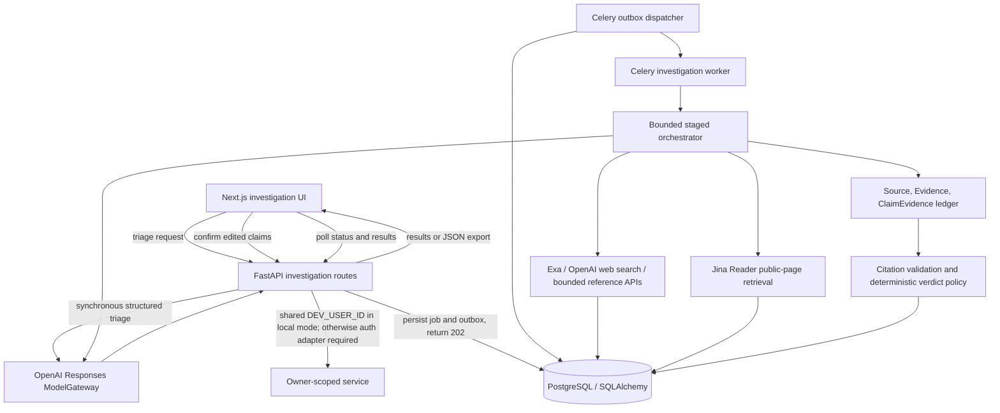

# Agent Zero architecture audit — 2026-10-26

**Status:** Repository audit updated with verified export, worker lease, and model-output validation slices
**Branch:** `feat/agent0-public-frontend`
**Purpose:** Reconcile ADR-001's proposed bounded adaptive architecture with the current implementation before selecting the next implementation slice.

## Executive summary

The repository already has a working, application-controlled investigation pipeline with claim triage, bounded search and retrieval, durable source/evidence records, exact-excerpt citation validation, deterministic verdict enforcement, staged job state, and a user-facing results projection. The ADR is a useful target architecture, but it describes several existing capabilities as if they were absent. A replacement orchestrator, universal crawler, second evidence ledger, or new verdict policy would duplicate working code and add risk.

The current workflow is a **bounded staged pipeline with persisted stage transitions**, not a model-directed adaptive action loop. Search widening is determined by application rules and evidence sufficiency; the model does not select executable actions. That is a deliberate and safer current boundary, and it should remain unless an evaluation demonstrates that a controlled action loop improves the product.

The backend is not just a prompt wrapper: request schemas validate intake, the orchestrator owns search budgets and source routing, evidence admission checks investigation/claim ownership and exact retrieved excerpts, citation checks filter unsupported sentences, and `verdict_policy.py` deterministically derives final verdict and evidence confidence. Recent deepening tightened the model-output seam: claim normalization and query-to-claim references are now computed/validated in application code; the model no longer returns fields that persistence discarded; and prompt instructions label supplied and retrieved text as untrusted data. A product-contract mismatch remains between the approved outcome vocabulary and the API/database vocabulary; resolve it before changing public labels or verdict semantics.

The product lead has withdrawn Agent Zero from the hackathon. Zetaris and Nightshift are out of scope and will not be used; the Zetaris deployment stays suspended. Persistent human review remains blocked on a trustworthy reviewer identity; the current local owner is shared. The first safe product slice is now JSON export from the existing persisted results projection, followed by a deliberate reviewer identity decision.

## Source-of-truth and workspace state

- `AGENTS.md` requires reading `.sinaps/state.md` and `docs/OPEN-QUESTIONS.md`; both were read.
- `.sinaps/state.md` records Slice 2 (claim triage, evidence ledger, citation validation) as complete and human review plus JSON export as the then-next slice. The hackathon sponsor priority was later withdrawn; product work now resumes with export.
- `docs/OPEN-QUESTIONS.md` keeps production identity, retention/deletion, provider handling/deployment, and human review identity open.
- Branch is `feat/agent0-public-frontend`, tracking `origin/feat/agent0-public-frontend`. Recent commits merge claim triage and evidence-ledger slices. Existing untracked file `docs/engineering/plan-hackathon-sponsor-integration-2026-10-27.md` is present and was not modified by this audit.
- Current `sinaps health` result is BLOCKED on project disk capacity (6% free in the recorded check). No tests, package installation, container start, migration, AWS call, or live provider request was made in this audit. The last recorded backend baseline in `.sinaps/state.md` is 133 passed with 3 baseline failures; it is historical, not a fresh result for this checkout.

## Current implementation map

| Concern | Existing implementation | Audit status |
|---|---|---|
| Intake, ownership, and lifecycle | `backend/app/modules/investigations/routes.py`, `service.py`, and `backend/app/domain/investigation.py` | Implemented. API reads use `InvestigationService.get(..., owner_id=...)`; local dev/test maps requests to one `DEV_USER_ID`. Production/staging auth intentionally fails closed because the adapter is not implemented. |
| Durable processing | `models.py` (`ProcessingJob`, `OutboxEvent`, `AuditEvent`), `tasks.py`, `orchestrator.py` | Implemented as queued jobs/outbox, persisted lifecycle stages, and audit events. This is not full step-level checkpoint/resume: the job has stage/status/error/attempt fields, while arbitrary action proposals/results are not represented as first-class records. |
| Claim triage | `investigator.py` (`ResearchPlan`, `PlannedClaim`, `PlannedQuery`), `triage.py`, `orchestrator.py`, claim models | Implemented. Structured output is validated; normalized claim text is derived from the actual claim text, and query claim indexes outside the persisted claim set are discarded. Ambiguous or claimless input avoids invented factual findings. A deliberate URL-only discovery fallback may persist an unassociated query without creating a claim. |
| Search/discovery | `backend/app/modules/sources/exa_search.py`, `openai_web_search.py`, `settled_fact.py`, registry and source-prioritization modules | Implemented with existing Exa/OpenAI web-search routes, source lanes, query traces, and a bounded settled-fact lookup. Search traces preserve provider/query/candidate metadata. This is not a generic `SearchProvider` plugin registry. |
| Retrieval and extraction | `backend/app/modules/sources/retrieval.py`, `evidence_extraction.py`, `orchestrator.py` | Implemented for bounded public-page retrieval through Jina Reader, deterministic source metadata/URL handling, evidence localization, and private object-storage retention of retrieved text. `retrieval.py` checks public/global destinations and applies request limits. PDF-like evidence localization is covered by text fixtures, but this checkout has no first-party PDF parser; document extraction depends on the upstream reader response. No general browser renderer or broad connector framework exists. |
| Evidence ledger | `models.py` (`Source`, `Evidence`, `ClaimEvidence`, `FindingEvidence`, `SourceRelationship`), `evidence_ledger.py`, migrations through `0015_processing_job_lease.py` | Implemented. Exact excerpt offsets, validation state, source tier, stance, independence group, claim/finding links, source relationships, and retrieval provenance are persisted. Legacy evidence is conservatively unvalidated/unknown. Do not add a parallel evidence representation. |
| Assessment and verdicts | `investigator.py`, `orchestrator.py`, `verdict_policy.py` | Application validates claim/evidence IDs, retrieved origin, exact excerpt support, and deterministic sufficiency. The model now proposes only status, evidence relationships, cited explanation sentences, and limitations; application code creates the statement and confidence rationale, while the UI derives next steps. **Contract mismatch:** code persists `SUPPORTED`, `CONTRADICTED`, `PARTLY_TRUE`, `INSUFFICIENT_EVIDENCE`, and `NOT_VERIFIABLE`; approved product requirements specify `SUPPORTED`, `CONTRADICTED`, `UNVERIFIED`, and `INCONCLUSIVE` (plus contextual classifications), and reserve `INCONCLUSIVE` for material conflict. The current policy maps mixed support/contradiction to `PARTLY_TRUE`. Reconcile before changing labels or migration/API contracts. |
| Budgets and stopping | `config.py`, `usage.py`, `orchestrator.py`, search/retrieval helpers | Partially implemented. Model-call, query, source, text, retry, and wall-clock budgets exist. Budget cuts are recorded as limitations and affect findings. A canonical persisted `stopping_reason` distinct from status, failure, and free-text limitations is not present. |
| Provider boundary | `investigator.py` (`ModelGateway._structured_call`), `config.py`, `provider_errors.py`, `usage.py` | OpenAI Responses API only. Model calls are wrapped by one gateway and provider errors are normalized, but the gateway constructs `AsyncOpenAI`/`OpenAIResponsesModel` directly. Call usage stores provider/model/purpose. No provider-neutral adapter/capability interface or Meterless settings exist. |
| Results/API projection and export | `routes.py` `GET /{investigation_id}/results` and `/export`, frontend investigate page and API proxy | Implemented and verified. The JSON download wraps the existing owner-scoped persisted-results projection, adds investigation identity/timestamps/status, and excludes private storage metadata. Backend export and owner-scope tests pass. |
| Human review | `models.py`, routes, frontend | Missing as a persisted editorial decision. `NEEDS_REVIEW` is a processing status, not a human decision record. Shared development identity is unsuitable for reviewer attribution or multi-user review. Do not add a review write endpoint until identity/isolation is resolved. |
| Zetaris / Meterless | Repository and Compose search; prior local endpoint/process inventory | No integration code/configuration present. The product lead withdrew from the hackathon and confirmed these integrations will not be used. Zetaris remains suspended; both integrations are excluded from the active product plan. |

## Domain and lifecycle findings

1. The system has durable investigation, source, evidence, finding, usage, search-trace, processing-job, and audit-event records. Persistence is already the case record; model context is not the only store.
2. `orchestrator.py::process_investigation` owns an explicit lifecycle: triage, source preparation, fast path, primary search/retrieval, conditional reporting and fact-check widening, optional social route, evidence reasoning, and brief generation. Application code owns each stage and its limits.
3. The agent currently proposes claims and queries, but does not choose among a finite set of executable actions in a repeated PLAN/OBSERVE loop. Adding `ResearchTask`/`ActionProposal` tables before a concrete resumability or quality need is shown would be speculative.
4. Sources and evidence are separate. Search candidates and retrieval failures remain visible as source records/traces; validated evidence requires a stored passage with provenance and exact-text checks. This already supports the ADR's evidence-first principle.
5. Stopping is observable through status, job state/error, audit events, usage limitations, and deadline-cut messages, but not through one typed reason field. This is a real bounded gap if reports/evaluation need to distinguish adequate completion, budget exhaustion, unavailable sources, and clarification.
6. JSON export now reuses the existing result projection as a download wrapper, not a second serializer or model-generated reconstruction. Its security scope matches the existing API owner's access policy.

## Review against the submitted Django diagram

The diagram is conceptual, but its labels and sequence should not be presented as the current implementation without these corrections.

The repository's actual high-level flow is closer to:

The box labeled “Owner-scoped service” is currently a function boundary, not an authentication system. The successful model calls used for triage run during the HTTP request; research after the user confirms triage runs in Celery. The worker uses persisted jobs, traces, sources, evidence, findings and audit events, but it does not persist generic action proposals or assessment versions.

| Diagram claim | What the repository does | Classification and action |
|---|---|---|
| Django REST API, Django serializers and Django ORM | `backend/app/main.py` is FastAPI; endpoints use Pydantic request/response schemas; persistence uses SQLAlchemy models and Alembic migrations. `pyproject.toml` has no Django/DRF dependencies. | **Diagram mismatch.** Keep the existing FastAPI/SQLAlchemy architecture; correct the diagram language. A Django rewrite has no product benefit. |
| Request receives, authorizes, creates and quickly returns an investigation ID | `POST /investigations` persists and returns 202. The frontend's triage-first path calls `POST /investigations/triage`, which invokes the model synchronously before returning proposed claims; it can hold the request open for a model call. | **Latency and resilience risk.** Measure real triage latency and request timeout behavior. If it exceeds the API/deployment budget, move triage to an asynchronous draft job while preserving the user's claim-edit confirmation step. |
| Service can create, authorize, resume and cancel | Creation and ownership-scoped reads exist. Retry is available for `NEEDS_REVIEW`/`FAILED`. `CANCELLED` is a domain status with allowed transitions, but there is no cancel route or cooperative worker cancellation path. | **Incomplete lifecycle contract.** Either add a bounded cancel endpoint plus worker checks and race tests, or remove cancellation from the exposed lifecycle/diagram until supported. Retry is not general resume from an arbitrary checkpoint. |
| Model proposes next actions and an executor validates/executes each iteration | The model proposes claims and search queries. `process_investigation` selects fixed search lanes and widens them using deterministic evidence/source-count rules; it does not repeatedly ask the model to select a registered action. The model is constructed without tools, and `max_turns=1`. | **Architecture mismatch, not a defect.** Describe the shipped system as a bounded staged pipeline. Keep retrieved text from becoming executable instructions. A model-directed loop should require an evaluation-backed need, finite action schemas, persistence, and explicit budgets first. |
| Claim Service and Assessment Service are distinct modules | Claim persistence is coordinated by route/orchestrator helpers; evidence assessment is coordinated by `_persist_findings` and the pure verdict-policy module. | **Boundary is combined, not absent.** Keep current seams unless changes become hard to test; do not create Django apps/classes merely to match the diagram. |
| Every action has a durable action record | Search actions have `SearchTrace`; model calls have `ModelUsageRecord`; retrieval state is on `Source`; lifecycle events are in `AuditEvent`. There is no generic action record spanning these operations. | **Partial traceability.** Current operations have domain-specific records. Add a common action record only if a real recovery, audit, or reporting use case cannot be served by those records. |
| Worker/job execution is idempotent under duplicate delivery | A new working-tree change atomically claims only `QUEUED` jobs using a PostgreSQL update, stores an ownership token/generation/expiry, renews the lease, and fences each pipeline commit. Duplicate `RUNNING` deliveries are skipped. Expired leases are blocked by recovery, which clears the token; the user retry path creates a new job rather than resuming a checkpoint. | **Fix implemented; verification pending.** Focused tests cover duplicate claim, changed/expired token fencing, and stalled recovery. They have not run because disk health is blocked. Run these against PostgreSQL before relying on row-lock and clock behavior. |
| Assessment versions are preserved | `Finding` stores one current row per claim in practice; `_persist_findings` skips claims with an existing finding. There is no assessment version table or immutable assessment history. | **Historical comparison gap.** Before allowing re-assessment after added evidence, define assessment versioning and review invalidation. Do not silently overwrite or imply prior assessments are preserved. |
| Every final result records a typed stop reason | Status, job state, failure reason, audit events, and usage limitations record parts of why processing ended; no canonical typed stop-reason field is persisted. | **Reporting gap.** Add typed stop reasons when consumers need to distinguish adequate completion, budget stop, clarification, source unavailability, and provider failure. Derive them in application code. |
| Every human review is separately authorized and auditable | No editorial decision model or route exists. Local development/test requests share `DEV_USER_ID`; production/staging fails closed because authentication is unimplemented. | **Blocking security gap for review.** Do not add persistent review writes until reviewer identity and investigation authorization are real. Choose either an authenticated multi-user model or an explicitly private single-operator deployment. |
| API rate limits protect the public demo | Per-investigation model/search/source budgets exist, but this repository scan found no request-level rate limiter. | **Abuse/cost exposure if publicly reachable.** Add ingress/API rate limits and aggregate spend/concurrency caps before inviting unrestricted public traffic; per-case caps do not bound total requests. |
| Retrieved content is treated as untrusted data | `docs/architecture/architecture.md` requires this and model calls have no tools. The investigation prompt text itself does not clearly mark retrieved passages as untrusted or explicitly say to ignore instructions embedded in those passages. | **Defense-in-depth gap.** Add clear untrusted-content framing at every prompt boundary (claim extraction from submitted pages and evidence reasoning) and a prompt-injection fixture. Deterministic evidence checks remain mandatory; prompt wording alone is not a security boundary. |
| Evidence and assessment are a final stage after research | The orchestrator persists source and evidence records before assessment, links evidence to claims, and validates citations/verdict sufficiency in application code. | **Aligned in substance.** Keep the ledger authoritative; a separate Django app/class is unnecessary. |
| Search, HTTP, feeds, APIs and browser are interchangeable adapters | Search and public-page retrieval are separate modules, with source registry/localization helpers. No general adapter interface, feeds, browser renderer, or broad connector catalog was found. | **Scope boundary.** Document the supported routes honestly; add a connector only for a concrete source need and verified access contract. |

### Prioritized remediation

1. **Before accepting public traffic:** verify the new job claim/lease behavior against PostgreSQL, then implement authenticated owner identity and request/aggregate rate limits, or keep deployment explicitly private/single-operator.
2. **Before recording editorial decisions:** implement authenticated reviewer identity and investigation-level authorization; then preserve decision history separately from AI findings.
3. **Before claiming resumability/cancellation:** add explicit cancel semantics and prove retry behavior around persisted stages. Do not label retry as checkpoint resume.
4. **Before expanding agent autonomy:** harden untrusted-text boundaries and add injection tests; only then consider a finite application-owned action registry if evaluation justifies it.
5. **For report integrity:** add typed stop reasons and assessment versioning when assessment reruns become a supported behavior.
6. **For synchronous triage:** measure request latency first; move it to a draft job only if current deployment timeouts or UX make synchronous triage unreliable.

These are audit findings and recommendations, not a Django migration plan. Working-tree implementation includes persisted JSON export, PostgreSQL-backed job claim/lease fencing, retry-plan recovery, deterministic claim normalization, bounded query-index validation, and strict model-output contracts. This follow-up adds regression coverage for duplicate findings, source-injection text with invented evidence IDs, and unexpected structured-output fields; it also rejects duplicate findings for one claim instead of allowing order-dependent persistence. Focused backend verification currently passes 60 tests. Privacy-safe OpenTelemetry spans are opt-in via an OTLP endpoint and contain no user/source content. PostgreSQL concurrent-claim, heartbeat, expiry-fence, stale-worker, and recovery probes pass against a throwaway database after the full Alembic chain reached `0015`. The existing local Agent Zero database remains at `0009`; see [migration 0015 runbook](migrations/0015-processing-job-lease.md) before applying there or in a deployment.

### OSS candidate fit

Trafilatura was not added: the existing retrieval boundary receives Jina Reader's converted text, not raw HTML, so swapping the current passage selector would not use Trafilatura's main-text extraction. A meaningful benchmark needs representative saved raw-HTML fixtures and an explicit direct-HTML retrieval path; neither exists in this repository. Docling remains deferred until representative PDF failures establish a need. Giskard and Ragas remain evaluation options, not runtime dependencies; curated deterministic fixtures are the current regression baseline. OpenTelemetry was added as manual, opt-in instrumentation rather than automatic HTTP/model instrumentation, to avoid capturing request or source bodies.

## Ranked opportunities

### P1 — JSON case export (implemented and verified)

The current slice exports the saved results projection as versioned JSON, preserving evidence, sources, links, validation, traces, timestamps, findings, and limitations. It uses existing owner-scoped API access and does not recreate case content from model summaries. It keeps storage keys, private media metadata, and nonexistent human decisions out of the export. Tests verify saved data, private metadata omission, and owner scoping.

### P2 — Typed stopping outcome

Add a small, versioned stop-reason contract only after confirming the report/API consumers and migration convention. Derive it from actual pipeline outcomes, not a model self-report. Keep failure status, user-facing limitations, and stopping reason distinct. Acceptance checks should cover complete-with-adequate-evidence, deadline/budget cut, clarification required, and retrieval/provider failure; the current `NEEDS_REVIEW`/`FAILED` behavior must remain unchanged unless separately decided.

### P3 — Human review (after identity decision)

The data model must preserve AI findings and reviewer decisions separately. `current_owner_id()`'s shared local identity means the app cannot claim reviewer isolation. Keep review writes disabled for public multi-visitor usage until authenticated identity or a properly scoped single-operator demo boundary is in place. This does not block read-only local product design.

### Deferred — General adaptive loop and broad source framework

Do not replace `process_investigation` with a general action engine or create a new adapter registry as a deadline-driven precondition. First add typed per-step checkpoints only if a recovery requirement cannot be met with the existing durable job/stage model. Add source adapters only when a real connector use case and tested contract exist. A broad crawler, browser renderer, mandatory vector store, microservices, and multi-agent framework are not justified by the current implementation.

## Verification and execution constraints

- Focused verification for this revision ran within available resources; the last Sinaps health check remains blocked on low free disk and elevated memory/swap use. Full-stack browser/E2E checks remain deferred until health is rechecked.
- The existing local PostgreSQL database is still at migration `0009`; only an isolated throwaway database was migrated to `0015` for verification. Follow the migration runbook before migrating a persistent or deployed database.
- The approved product outcome contract and implemented API/database verdict enums differ. `PARTLY_TRUE` currently represents any eligible support and contradiction signals; product requirements reserve `INCONCLUSIVE` for material conflict. Decide whether to migrate to the approved vocabulary or revise the approved product contract, then add an explicit same-proposition conflict regression.
- Prompt instructions now label supplied/retrieved text as untrusted and forbid embedded directions from changing policy. A hostile-page fixture that verifies the complete claim-extraction-to-assessment behavior is still missing; prompt wording is defense in depth, not an enforcement boundary.
- No live Meterless call can currently verify provider configuration, authentication, structured-output compatibility, mode, or failure handling.
- No live Zetaris query can verify the source contract or demonstrate sponsor data use while its deployment is suspended and access details are unknown.

## Decision for this checkout

The hackathon sponsor integration plan is inactive. Do not add Nightshift, Zetaris, or Meterless Engine code. The repository is substantially ahead of the ADR's assumed baseline, so continue by incrementally deepening existing seams. JSON export, worker leases, deterministic claim normalization, and model-output contract cleanup are implemented and focused verification passes. Human review remains deferred until reviewer identity and case-level authorization can be trusted.
